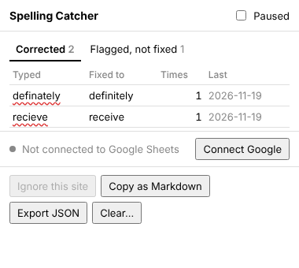

# Spelling Catcher

A Chrome extension that keeps a running tally of the words you misspell — specifically the ones you **misspell and then fix**, which is a much stronger signal than whatever the red squiggle flags. Corrections sync to a Google Sheet in your own Drive, where Claude (or anything else) can read them for analysis and flashcards.



## For users

1. Install the extension.
2. Click **Connect Google** in the popup and allow access.

That's it. The extension creates a **Spelling Catcher** sheet in your Drive with three tabs:

| Tab | Contents |
|---|---|
| **Log** | One row per correction: `Timestamp, Date, Typed, Fixed to` |
| **Summary** | Live pivot: each misspelling, what you fixed it to, how often, last seen |
| **Reviews** | Empty, for flashcard/quiz results (`Date, Word, Result, Notes`) — e.g. written by Claude via the Google Sheets connector |

## What leaves your machine

Only correction pairs — `recieve → receive` plus a timestamp — and only to your own Google Sheet. The extension asks for the `drive.file` scope, so it can see only the files it created, not the rest of your Drive.

Never synced:
- The text around a word, or what site you were on (both stay local, for the popup).
- **Flagged-but-unfixed words.** A letters-only password typed into a plain field would look exactly like a misspelling, so these never leave the machine. A password essentially never gets "corrected" into a nearby dictionary word, which is why corrections are safe to sync.

Never read at all:
- `type=password` fields, **including after a "show password" toggle** flips them to text.
- Fields whose `autocomplete`, name, id, label or placeholder suggests a password, one-time code, PIN, token, API key, card or account number.
- Non-text inputs (email, number, tel, …), large pastes, and code-ish tokens (`foo.bar`, emails, URLs, `snake_case`, anything with digits).

The extension does run on every site (so Chrome warns "read and change all your data on all websites"); that's inherent to catching typos everywhere. Pause it or ignore a site from the popup.

## How it works

Chrome's built-in spellchecker doesn't expose results to extensions, so this runs its own check alongside it:

1. **`content.js`** watches textareas, plain text inputs and contenteditable fields (Gmail, claude.ai, Slack web, …) in every frame and takes a debounced snapshot of the text and caret position.
2. **`core.js`** diffs consecutive snapshots at the word level. A word counts as *finished* once the caret leaves it. If a finished word is later edited into something else — the right-click suggestion, backspacing and retyping, or clicking back into it — that's a `replace` event. Enter (without Shift) and blur finish the last word, so chat boxes that clear on send are covered.
3. **`background.js`** judges events against a Hunspell en_US word list. A **correction** is: the original wasn't a word, the result is, and they're within a small edit distance. Corrections go into an outbox.
4. **`sync.js`** appends the outbox to the sheet via the Sheets API (15 s after a correction, and every 5 min), recreating the sheet if you delete it.

## Developer setup (one time)

Google requires the app to be registered so the consent screen can name it. Users never see this.

1. [Google Cloud Console](https://console.cloud.google.com/) → create a project.
2. **APIs & Services → Library** → enable **Google Sheets API**.
3. **OAuth consent screen** → External; app name "Spelling Catcher"; add scope `.../auth/drive.file`; while in Testing, add yourself as a test user.
4. **Credentials → Create credentials → OAuth client ID** → type **Chrome Extension** → Item ID `aefmdgcflccnjemdpomlonpdbjplakcp` (pinned by the `key` in `manifest.json`).
5. Put the client ID in `extension/manifest.json` → `oauth2.client_id`.

Load it: `chrome://extensions` → Developer mode → **Load unpacked** → `extension/`.

When publishing to the Chrome Web Store, the store item gets its own ID: add a second OAuth client for that ID (or copy the store item's public key into `key` so dev and store builds share an ID). `drive.file` is a non-sensitive scope, so Google's verification is the light brand check, not a security assessment.

## Development

```sh
npm test            # diff/judgement + sync logic (node:test, no deps)
npm run e2e         # loads the extension in headless Chrome via Playwright and types into real fields
npm run build:dict  # regenerate extension/words.txt from the system Hunspell dictionary
```

`words.txt` is committed (≈167k words, 1.6 MB) so the extension loads with no build step.

## Not yet

- Real-word errors (`form`→`from`, `their`→`there`) are deliberately dropped: both sides are valid words, and they can't be told apart from ordinary rewording yet.
- Native macOS apps — that would need an Accessibility-API companion app.
